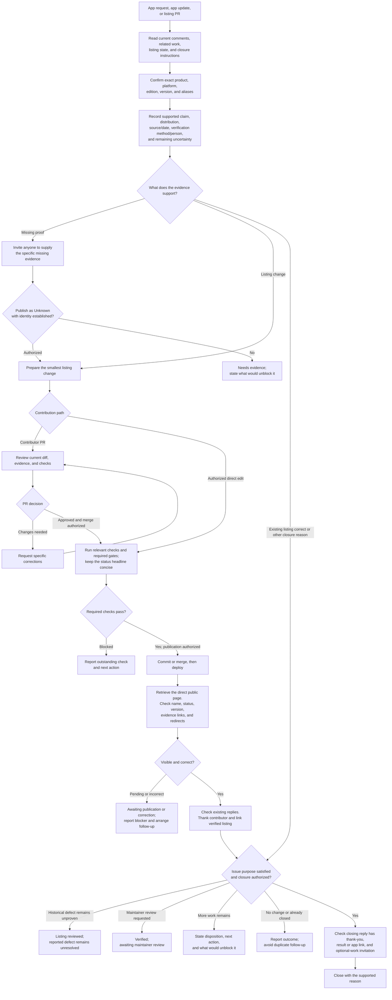

# App review GitHub flow

Review app requests and updates through an evidence-backed decision, authorized
listing changes, public verification, and contributor follow-up.

## Required contributor follow-up

Read this guide before handling app-request issues or app-listing pull requests.

1. Thank the contributor by their GitHub handle for the app or compatibility information they provided.
2. Include a direct Markdown link to the app's listing on `https://doesitarm.com` in merge and completion replies, for example `[Dusty on Does It ARM](https://doesitarm.com/app/dusty)`. The homepage, a GitHub diff, or the developer's website is not a substitute. For multiple apps, include a link for each.
3. Resolve the listing URL from the app's API `endpoint` or the repo's slug and endpoint helpers. Check redirects rather than guessing a URL from the PR title.
4. If deployment or verification is pending, still provide the expected listing URL, clearly label it as pending, and say it has not yet been verified live.
5. After the deployment finishes, open the public listing and verify the app name, compatibility status, version, and evidence links. The API and frontend deploy separately; a successful frontend build alone does not prove the new listing is live.
6. Reply on the PR or issue with the verified listing link and a short thank-you. Check existing comments first to avoid duplicate acknowledgments or live announcements. For listing-completion closures, verify the listing first and include its link. Follow the disposition and closure rules below before changing the issue state.
7. Before closing any issue, include a brief, friendly invitation to contribute again in the closing comment. Invite people to [browse the app list](https://doesitarm.com), [suggest another app](https://github.com/ThatGuySam/doesitarm/issues/new?template=app-request-template.yml), or [help with missing compatibility information](https://github.com/ThatGuySam/doesitarm/issues?q=is%3Aopen+is%3Aissue+label%3A%22Needs+M1+Testing%22). Pick the invitation that fits the contribution; one sentence is enough. Keep it optional and welcoming, with no obligation to do more work. This applies to completed, duplicate, and not-planned issue closures, including feature and bug issues. For non-listing issues, link the relevant result or explanation instead of inventing an app URL.
8. Treat the invitation as part of the closure checklist, not optional polish: verify the closing comment contains the thank-you, the result or direct app link, and the invitation before changing the issue state. If the user requests review before closure, leave the issue open and prepare the closing reply for that later step.

Example after verification:

> Thanks @contributor for adding Dusty and its compatibility evidence! It's now live: [Dusty on Does It ARM](https://doesitarm.com/app/dusty). Feel free to [browse the app list](https://doesitarm.com) and [suggest another app](https://github.com/ThatGuySam/doesitarm/issues/new?template=app-request-template.yml) you'd like us to review!

If deployment or public-page verification fails, report the actual blocker and arrange follow-up. Do not announce that the app is live until verified.

## Recover the current state

Read the current body, comments, related issues and PRs, and current listing.
Check for completed work, existing acknowledgments, and instructions to leave
the issue open. An open issue is not proof that no work has been done. Preserve
an explicit maintainer-review hold when resuming.

For newest issues, query live GitHub data in descending `createdAt` order,
including closed and unlabeled issues unless the request narrows the scope.
An updated-at queue answers a different question. Include the issue link and
one concrete next action for every result, including no action for a withdrawn
request that is already closed.

## Review criteria

Use the current [PR template](../.github/PULL_REQUEST_TEMPLATE/app_addition_template.md) for listing format, ordering, status wording, and supported-version requirements. Use the matching [request](../.github/ISSUE_TEMPLATE/app-request-template.yml) or [update](../.github/ISSUE_TEMPLATE/app-update-template.yml) form for issue completeness. Check the existing README category, duplicates, and related contributions.

- Confirm the exact product, edition, platform, and aliases before using evidence. Related products, successors, host apps, plugins, and ARM guest images do not establish one another's compatibility.
- Open the official app/download page and compatibility evidence. Confirm that the evidence supports the stated architecture, app version, and stable or prerelease channel. Distinguish native or universal binaries from translation support. Identify official, community, and source builds and the installation path covered. Source builds can be valid when they are normal for that app's users; community evidence does not establish an official stable release.
- Prefer a versioned release or other durable evidence for a version-specific claim. A moving `latest` URL, mismatched version, or broken link needs reconciliation. Use a verifiable version or request the missing evidence; do not invent one or assume the newest release proves the first supported version.
- Distinguish contributor-provided screenshots or binary inspection output from checks performed independently. Report whether the review inspected sources, inspected a binary, or actually ran the Mac app, and who performed each check. Explicit official architecture documentation or binary inspection can support a native claim without comprehensive runtime testing. Mac App Store availability alone, an M1 source branch, or compatible dependencies do not establish a native working app. Binary architecture does not establish working features; a newer supported version does not establish that a historical defect was fixed.
- Inspect check and deployment details for the reviewed commit. Authorization requests and missing checks are not demonstrated build failures or successful checks. Respect required merge gates; report the actual cause and any uncertainty.
- For README-only edits, validate the changed entries against the template, evidence, category ordering, duplicates, and parsing where applicable. Read `package.json` and the affected tests for current commands; run relevant checks and required gates without expanding into unrelated refactors. Apply the status regressions below to status or typography changes. Documentation-only policy edits do not require responsive app testing. Report a blocked required check as outstanding; do not silently waive it or treat an unrelated environment failure as a listing defect.

### Evidence record

Keep a compact record in the review output or linked review notes. Use
`unknown` or `not checked` for gaps rather than filling them by inference.

| Field | Record |
| --- | --- |
| Product and version | Exact product, edition/platform, version covered, and relevant aliases |
| Distribution | Stable/beta/RC, official/community/source build, and installation path |
| Supported claim | Architecture or specific behavior the evidence establishes |
| Source and date | Evidence URL, release date when available, and date checked |
| Verification | Documentation, binary inspection, or runtime testing, and who performed it |
| Limitation | Unproven behavior, version mismatch, or other unresolved uncertainty |

Do not paste the full research record into every contributor reply. Keep the
reply short, state the supported outcome, and give one next step when needed.

## Disposition and next action

Choose the disposition that describes the current state, separately from the
app's compatibility status. State the next action and what would unblock it.

| Disposition | Next action |
| --- | --- |
| No change needed | Explain the existing listing or closed outcome; avoid duplicate follow-up |
| Listing correction or addition needed | Make or recommend the smallest supported change |
| Needs evidence | Invite anyone to supply the specific missing evidence without obligating the reporter |
| Awaiting publication | Identify the pending deployment, correction, or direct-page verification |
| Verified; awaiting maintainer review | Leave the issue open and preserve the review hold |
| Ready for authorized closure | State the closure reason and check the required closing reply |

An Unknown listing may be published to invite testing when product identity
is established, the uncertainty is clear, and publication is authorized. Do
not replace missing proof with an unsupported native or Intel-only claim.

Verify publication by retrieving the direct public page and checking its name,
status, version, and evidence links, including redirects. Use search to find
sources, not to establish deployment state. If verification remains blocked,
report the blocker and next action rather than polling indefinitely.

Close only when the issue's purpose is satisfied and closure is authorized.
A corrected listing does not resolve an unproven historical defect. A
discontinued product may warrant closure for that stated reason, without a
compatibility-fix claim or an invented live listing. Honor maintainer-review
holds and the contributor follow-up checklist on every closure path.

Report reviewed, committed or merged, deployed, and verified-live states
separately. A recommendation to change or close an issue is not authorization
to perform that action.

## Status headline length

- Keep the status to **80 Unicode code points maximum**, including the status symbol, spaces, punctuation, and version. Aim for 40–65 characters. State support, the relevant version, and at most one essential qualification.
- Render the full status in **no more than three lines at 320 CSS pixels and wider**, with two lines as the desktop target. The site uses a 20px root font, so do not assume Tailwind's usual 16px rem size. Character count alone does not prove that a headline fits.
- Keep qualifications that change the answer visible, such as beta, Rosetta, partial support, or unverified status. Preserve longer setup steps, platform requirements, limitations, and evidence in a GitHub issue comment or [app status details](app-status-details.md), then add a direct `Requirements & details` link to that section.
- Never use line clamping, ellipses, or hidden overflow to meet the line limit. Text enlargement may add lines for accessibility; do not clip it or shrink text to defeat the user's font setting.
- Run `pnpm test:status-copy` and `pnpm test:status-headlines` before publishing status or typography changes. The responsive test checks every README app status at 320, 375, 430, 768, 1024, and 1440px and checks enlarged text remains visible.

This budget comes from the app list before the September 7, 2026 bulk update: 808 statuses, median 42 characters, 95th percentile 62, longest 97. That history includes contributions from multiple authors, not only Sam. The 80-character ceiling allows a short qualification while excluding paragraph-length statuses.

## Request and review flow

